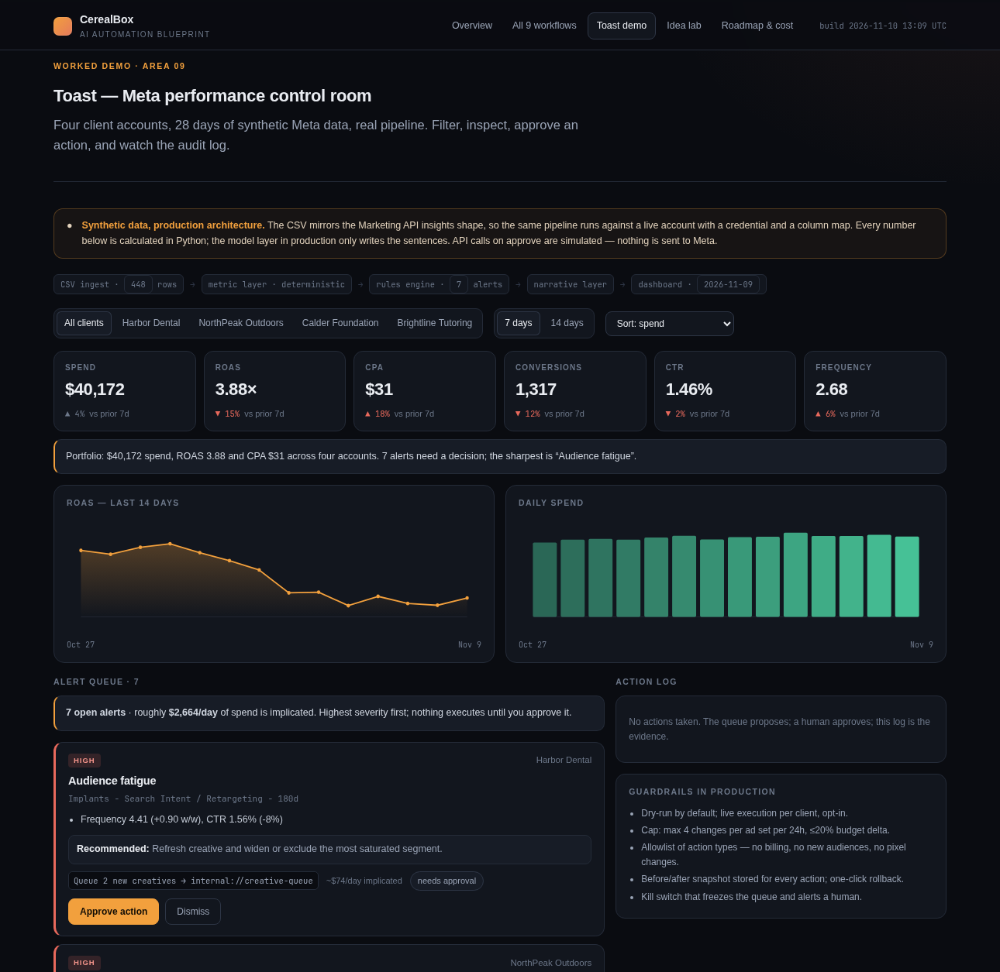

# AI Creative Workflow Blueprint

An AI automation and creative workflow system for a performance-marketing agency:
one brief in, a campaign out, and a measurement layer that feeds results back into
the next round of ideas.

This repository contains the architecture, the workflow design for all nine areas
of paid-social production, and one working prototype — a Meta ads analysis and
alerting dashboard driven by a real ingest → metrics → rules pipeline.



## View it

**Open the dashboard: <https://hassudo.github.io/ai-creative-workflow-blueprint/>**

Straight to the working demo: [/#toast](https://hassudo.github.io/ai-creative-workflow-blueprint/#toast)

No install and no server. `index.html` is one self-contained file — inline CSS, inline
JS, data embedded at build time — so it also works offline if you download the repo and
open the file. The other tabs are *Overview*, *All 9 workflows*, *Idea lab* and
*Roadmap & cost*.

To rebuild it from source, see [Rebuild it](#rebuild-it).

---

## What is in here

| Path | What it is |
|---|---|
| `index.html` | The whole thing, self-contained: architecture, all nine workflows, the working dashboard, the idea-engine design, the 90-day plan |
| `pipeline/` | The data pipeline behind the dashboard: sample generator, metric layer, rules engine, build step |
| `src/template.html` | Dashboard source (plain HTML/CSS/JS, no dependencies) |
| `data/` | Synthetic Meta export, account config, and the generated dashboard payload |

## The prototype: Toast

A Meta ads analysis layer for a multi-client agency. It ingests an ads export,
computes the metrics, applies an opinionated set of rules, and puts anything that
needs a decision in front of a human — with the evidence, an estimated daily cost,
and a proposed action.

**Pipeline**

```
CSV / Marketing API → metric layer (Python) → rules engine → narrative layer → dashboard
                                                                  ↓
                                                    approval queue → action log
```

**Rules currently implemented**

| Rule | What it catches |
|---|---|
| Audience fatigue | Frequency climbing while CTR decays |
| CPA inflation | Week-on-week cost per conversion increase |
| Over-target CPA | CPA above the account's target by a margin |
| Below breakeven | ROAS under 1.0 at meaningful spend |
| Zero-conversion creative | An ad spending with no conversions after converting previously |
| CTR floor | Weak hook at an expensive CPM |
| Delivery stall | Active ad set that stopped spending |
| Budget pacing | Spend running 20%+ above or below plan |

Every rule is a named threshold in `pipeline/toast_pipeline.py`; the whole set is
readable and arguable by a media buyer, which is deliberate.

**What is deterministic, and what is not**

- Metrics, deltas, severity, pacing and cost-at-stake are computed in Python. They
  are reproducible and testable.
- The language model layer, in production, receives that computed payload and writes
  the explanation. It never calculates a number. This is the central guardrail: an
  agent that can invent a ROAS is worse than no agent.
- The dashboard shows the deterministic layer only; the narrative text is templated
  from the same facts.

**Approval model**

Nothing executes without a human. The queue proposes an action, an approver accepts
or dismisses it, and every decision lands in an action log with a timestamp and the
simulated API call. Auto-eligible actions are labelled, and the intended guardrails
(daily change caps, budget deltas, allowlisted action types, rollback snapshots, kill
switch) are documented in the UI.

## Rebuild it

```bash
./run.sh
```

That regenerates the sample data, recomputes the metrics, and rebuilds `index.html`.
Python 3 standard library only — nothing to install.

To change the dashboard, edit `src/template.html` and re-run `./run.sh`.

## The data

`data/meta_ads_sample.csv` mirrors the shape of a Meta Marketing API insights export:

```
date, account_id, account_name, campaign_name, adset_name, ad_name, objective,
spend, impressions, reach, clicks, conversions, conversion_value
```

It covers 28 days across four accounts, generated deterministically (`seed=42`) with
deliberate anomalies injected so the rules engine has something real to find:
audience fatigue on a retargeting ad set, a creative that stops converting mid-flight,
CPA inflation on a donation campaign, a CTR below floor, a stalled delivery, and a
budget pacing overrun.

`data/accounts.json` holds per-account configuration — target CPA and monthly budget.
Pointing this at a live account is a credential and a column mapping, not a redesign.

## Design decisions

**Numbers in code, words in the model.** Every metric, delta, threshold and severity
is computed deterministically. Language models explain and prioritise; they do not
calculate. This is what prevents hallucinated performance data.

**Approval by risk tier, not by habit.** Data pulls, resizing and reporting run
unattended. Anything touching paid spend or a client's name requires one named human.
Regulated claims, likeness and policy-sensitive work requires a founder or legal
sign-off.

**Composite the brand, generate the image.** Image models should not draw logos,
prices or legal lines. In the static workflow, generated imagery is a background;
real brand assets and real type are composited in a template. That is what separates
usable creative from "looks AI-generated".

**Templates before volume, measurement before generation.** The repeatable parts are
templated so human judgement is spent where it matters — concept selection and idea
scoring.

## Scope

**Implemented:** the data pipeline, the metric layer, the rules engine, the dashboard,
the alert queue, the approval and audit flow, and the reproducible build.

**Designed, not implemented:** the generation workflows (copy, static, script, UGC,
editing, landing pages) are specified end to end — inputs, steps, tools, AI-versus-human
split, quality gates and outputs — but not wired up. The idea engine is specified as a
prompt template and rubric, with a hand-written scored example showing what is promoted,
what is killed as a duplicate and what is blocked for an unsubstantiated claim.

**Not connected to anything:** there is no live Meta account, no client data and no
external API call in this repository. Approve buttons are simulated and labelled as
such in the UI.

## Limitations

- **Synthetic data.** Real accounts will have messier campaign structures, naming and
  attribution than the sample.
- **Reach approximation.** Window frequency is approximated from daily reach with an
  overlap factor (`REACH_OVERLAP`). In production, frequency is read directly from the
  API at the requested window.
- **Template narrative.** The "what changed" copy is generated from facts in Python
  rather than by a model, so it is accurate but repetitive. Swapping in an LLM here is
  the intended next step.
- **Single currency and locale.** Multi-market work needs per-market offer facts and
  compliance rules in the brief schema.

## Layout

```
pipeline/make_sample_data.py   28 days x 4 accounts, deterministic, anomalies injected
pipeline/toast_pipeline.py     metric layer + rules engine -> data/toast_metrics.json
pipeline/build.py              injects the payload into src/template.html -> index.html
data/meta_ads_sample.csv       448 rows, Marketing API insights shape
data/accounts.json             account configuration
data/toast_metrics.json        dashboard payload
src/template.html              dashboard source, single file, no dependencies
index.html                     generated output
```
